<div align="center">

# DiskWise

**See where your Mac's disk actually went — and undo every cleanup with one tap.**

Xcode `DerivedData` · `node_modules` · Docker.raw · Homebrew cache · crash dumps

**Nothing is ever deleted for real.** Every removal goes to the Trash and stays undoable
until you empty it. 8 MB · native SwiftUI · 10 UI languages · no telemetry · Apache-2.0


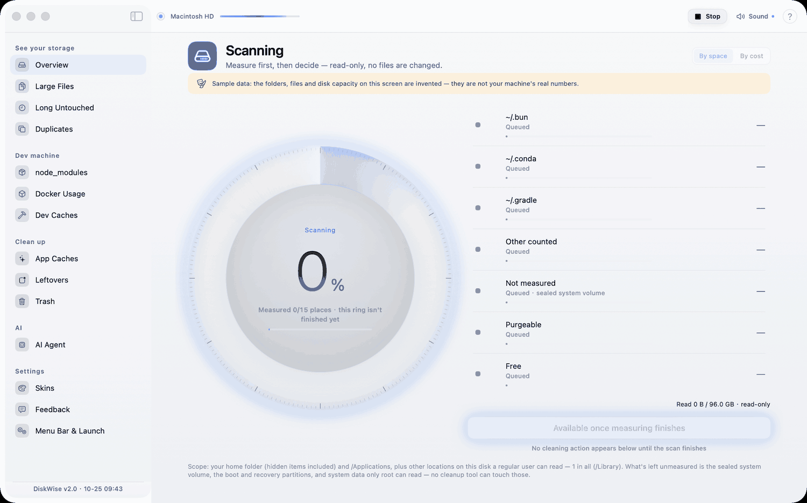

*Scan → open a row → two taps → undo. Shot against a synthetic home folder, so the numbers on screen are invented — the orange strip says so.*

```sh
brew tap DreamOfXM/diskwise https://github.com/DreamOfXM/diskwise
brew install --cask dreamofxm/diskwise/diskwise
```

**[Mac App Store](https://apps.apple.com/app/id6813265402)** · [DMG + SHA-256](https://github.com/DreamOfXM/diskwise/releases/latest) · [22-second demo](https://www.youtube.com/watch?v=0RfXNwNdzFg)

If it won back space you'd written off, a ⭐ is how the next person finds it.

English | [简体中文](./README.zh-CN.md) | [日本語](./README.ja.md) | [한국어](./README.ko.md)

</div>

---

| | |
|---|---|
| **Reads what actually grows** | `DerivedData`, `node_modules`, Docker.raw, Homebrew cache, Crashpad dumps — measured, grouped, and attributed to what wrote them. |
| **Growth, not just size** | Every scan is diffed against the previous one. A burst gets a red badge (**+2,674 files in under a minute**), slow creep gets amber, a folder you cleared reads as a decrease. |
| **Undo instead of a warning dialog** | Removals land in the Trash. Batch undo works until you empty it. There is no "smart clean" button that runs on its own. |
| **It declines** | A folder that looks like a cache but isn't structured like one is never flagged — it goes to a read-only list with the reason it isn't offered. |

*A free, open-source CleanMyMac alternative for the folders a developer actually fills up.*

<details>
<summary><b>What is actually safe to delete?</b> — 80 entries, each with what it costs you if you were wrong</summary>

[docs/safe-to-delete.md](./docs/safe-to-delete.md) covers 80 of the usual space hogs on macOS: what each one is, what deleting it does, and what it costs if you were wrong. It is generated from the same data the app reads at scan time (the tables are in Chinese; `Sources/DiskCleaner/Resources/safety_db.json` is the machine-readable original).

</details>

<details>
<summary><b>What's new in v2.3</b> — one incident: 2,674 crash dumps in 57 seconds</summary>

v2.3 came out of one incident: 2,674 crash dumps landed in Chrome's Crashpad folder in 57 seconds.
Every tool on that machine said "Chrome", and none of them were lying — the folder was Chrome's and
so was the executable path inside each dump. What put Chrome into a crash loop was something else
entirely, and the only place that said so was the environment captured inside the dumps themselves.
This release is built so that the same event reads itself off the screen instead of leaving you to
guess.

- **Crash dumps get named, not just counted.** Crashpad folders are recognized by their structure
  wherever an engine writes them, and attributed to the app that hosts the path. A look-alike folder
  without that structure is never flagged; it goes to a read-only list instead.
- **How fast something is growing, without a daemon.** Every scan leaves a snapshot, so each entry is
  compared with the previous one. A burst gets a red badge — the incident above reads back as
  +2,674 files in under a minute — slow accumulation gets amber, and a folder you cleared
  shows up as a decrease rather than an alarm.
- **What was actually driving it (off by default).** Turn on *Content probe* under *Diagnostics* in
  Settings (⌘,) and DiskWise reads the headers of a few sample dumps: the executable path, the
  bundle identifier, and any agent session fingerprints. In the incident above, that is the only place
  the real name appears. Fingerprints always display redacted and nothing leaves the machine.
- **Trim by retention.** The first time the category appears you're offered "keep the newest 2,000" —
  adopt it or dismiss it, one click either way, and nothing ever runs by itself. The preview is the
  result, whole batches undo, and the folder skeleton stays in place.
- **A home for what we only observe.** Everything the scan can see but this tool will never delete —
  system areas, admin-only report folders, look-alikes — now has a read-only page, each row carrying
  the reason it isn't offered.

v2.2 taught the scan to recognize the model caches that live inside your own projects, and to identify
an engine's self-managed cache by its layout on disk rather than by name.

</details>

## Contents

- [Quick start](#quick-start)
- [For AI agents](#for-ai-agents)
- [Why this exists](#why-this-exists)
- [What you get](#what-you-get)
- [Screenshots](#screenshots)
- [Install](#install)
- [Build from source](#build-from-source)
- [FAQ](#faq)
- [Known limits](#known-limits)
- [Roadmap](#roadmap)
- [Feedback](#feedback)
- [Privacy](#privacy)
- [License](#license)

## Quick start

The GIF at the top of this page plays this exact order:

1. Open **Overview** — it walks the whole volume and draws the result as one ring, with the ledger
   beside it.
2. Click any row in that ledger — the folders under it unfold right there, and the ring steps back
   to a small reference dial.
3. Click the arc you can move **twice**: the first click arms it, the second moves it to the Trash.
   *Undo* puts it back, and emptying the Trash stays Finder's call.

## For AI agents

The direct-download build ships a `diskwise` CLI (the App Store build doesn't), and it doubles as a
[Model Context Protocol](https://modelcontextprotocol.io) server — Claude Code, Cursor, Codex, Qoder,
OpenCode, Zed, ZCode and Claude Desktop can all reclaim disk space for you. It can't `rm -rf`: the only
removal path moves known-safe items to the Trash, every operation is undoable, and risky locations are
never touchable.

**Put DiskWise in `/Applications` before copying this.** The path below points at that copy; a build
left on the Desktop or run straight off the mounted DMG stops working the moment it moves or gets deleted.

Claude Code takes one line in Terminal:

```sh
claude mcp add diskwise -- "/Applications/DiskWise.app/Contents/MacOS/diskwise" mcp
```

**Or click to install**, no Terminal needed — the app registers itself as the server:

[Install in Cursor](cursor://anysphere.cursor-deeplink/mcp/install?name=diskwise&config=eyJjb21tYW5kIjoiL0FwcGxpY2F0aW9ucy9EaXNrV2lzZS5hcHAvQ29udGVudHMvTWFjT1MvZGlza3dpc2UiLCJhcmdzIjpbIm1jcCJdfQ==) · [Install in VS Code](vscode:mcp/install?%7B%22name%22%3A%20%22diskwise%22%2C%20%22command%22%3A%20%22%2FApplications%2FDiskWise.app%2FContents%2FMacOS%2Fdiskwise%22%2C%20%22args%22%3A%20%5B%22mcp%22%5D%7D)

These point at `/Applications/DiskWise.app`, so they only work once the direct-download build
is in that folder. The App Store build has no CLI, so it has nothing to register.

Then just ask your agent *"see what's worth cleaning on my Mac"* — it scans, drafts a plan,
shows you the summary, and only moves anything after you agree. The eight above are the ones we
verified line by line; any client that can host a local stdio MCP server takes the same two values —
this binary's path, and the `mcp` argument. If one of them can't connect, that's on the client:
issues and PRs welcome. Details, snippets for the other seven
clients and the full safety model: [docs/AGENTS-CLI.md](docs/AGENTS-CLI.md).

## Why this exists

A disk cleaner has to read a lot of your machine before it can tell you anything useful. Most of
them are closed-source, ship a background daemon, and treat `rm -rf` as a feature.

We go the other way:

| | DiskWise |
|---|---|
| Delete path | **One** — `FileManager.trashItem`. Everything lands in the Trash. |
| Undo | Yes, per operation, for the whole session. |
| Protected paths | Home itself, `~/Library`, and friends can never be removed wholesale. |
| Emptying the Trash | Finder does it, never this app. Direct build: the app asks Finder and you confirm once more. App Store build: the sandbox kills that event — measured behaviour, no permission prompt even appears — so the same button opens the Trash and you press ⌘⇧⌫. |
| Docker images | Read-only. Virtual disks have no per-image path, so the app points instead of pretending. |
| Network | None. No updater, no analytics, no ads. |
| Price | Nothing. Every feature and all six skins ship unlocked in this build. |
| Runtime | A single `.app`. No Python, no port, no daemon. |

The cache list explains each entry it can — what it is, what happens if you delete it, how it comes
back. We only write that text for entries we actually understand, so some rows carry it and some
don't. WeChat, DingTalk and WeCom are covered, because on many machines those three alone hold tens
of gigabytes.

It is built for machines that have been used by a developer for a few years — the ones where
`node_modules`, Docker volumes, Xcode `DerivedData`, and ten GB of caches quietly took over.

## What you get

**See the space**

- **Overview** — the volume drawn as one ring: a slice is a block of bytes this pass actually
  measured, and the slices add up to the whole disk (top folders + everything else counted + not
  measured + purgeable + free).
  - The light band sits exactly on the edge of what's been measured so far.
  - A slice you can move away whole takes two taps: the first arms it, the second sends it to the
    Trash, and it lets go on its own after 3 seconds.
  - The button under the ring opens a list, not a delete: one row per spot it can take, each
    saying what removing it costs, with the harmless ones pre-ticked and the re-downloadable ones
    left for you to tick. The next screen repeats that list as a confirmation, and only its button
    moves anything — the result screen after it puts the whole batch back.
  - There is one list, the ledger beside the ring. Open a row and its detail unfolds right there —
    the folders under it, the places behind *Other counted*, the volumes behind *Not measured*.
  - While a row is open the ring steps back to a small reference dial, and *Reveal* and *Dig in*
    sit on that row.
- **Whole-disk sweep** — no scope to guess at. The open-source build walks the whole volume
  (whitelisted system roots included, other users' homes included); the sandboxed Mac App Store
  build walks everything its grant can reach and says so on screen.
  - Either way it covers the volume, not just the tidy corners of your home folder.
- **A coverage line that names what it missed** — the overview states how much of your used space it
  actually measured, and names the rest: system volumes, admin-only folders, and folders blocked on
  Full Disk Access.
  - The *Grant access* button only appears when a real read of a protected file says the permission
    is actually missing, so a machine that already granted it never gets nagged again.
  - Every number is decimal, so it matches Finder and About This Mac byte for byte.
- **The "Other counted" slice adds up** — open that row and every place behind the arc is listed
  under it, and the last line spells the total out part by part (the rows listed, plus the ones
  under the 100 MB floor), because "a hundred-plus GB, trust me" is not an explanation.
- **Large Files** — top N across the same roots, dev directories skippable.
- **Long Untouched** — files you haven't opened in N days, across the same roots.
- **Duplicates** — size → partial hash → full hash, grouped, the newest copy in each group locked
  so you can't nuke the only one.
  - Copies that live inside a venv / site-packages / DerivedData never enter the comparison and are
    listed separately: delete one and that environment is short a piece.

**Dev machine specials**

- **node_modules** — project sweep grouped per project, so you see "these 3 checkouts cost 4.7 GB".
- **Docker Usage** — one row per container runtime actually installed (Docker Desktop, OrbStack,
  Podman, colima), measured as what its virtual disk takes on this disk, with the engine's own
  figures listed under it. Read-only: it points at where to prune, it never deletes for you.

**Clean up**

- **App Caches** — a curated knowledge base (system caches, crash dumps, WeChat / DingTalk / WeCom /
  QQ …). Every entry explains *what it is*, *what happens if you delete it*, and *how to get it
  back*, with a badge saying what deleting costs — Safe, re-downloadable, or data loss.
- **Dev Caches** — the same knowledge base, the tools half of these machines actually fill the disk
  with: Homebrew, npm / pnpm / yarn, Maven, Gradle, conda, uv, cargo, Ollama models, Xcode archives,
  DerivedData and every simulator device listed one by one.
- **Leftovers** — data orphaned by apps you already uninstalled, matched against the bundle IDs of
  everything still installed. Under-reports rather than over-deletes.
- **Trash** — session stats, undo stack, and an *Empty* button: outside the sandbox it asks Finder
  to do the emptying, in the App Store build it opens the Trash so you can press ⌘⇧⌫.

**Diagnostics & dumps**

- **Crash dumps** — Crashpad folders recognized by structure (`settings.dat` plus `completed/pending/new`),
  so any app that has ever crashed lands here on its own, with the host app attributed from the path.
  Every row carries growth since the previous scan: a red badge for bursts (2,674 dumps in 57 seconds
  reads back as exactly that), amber for slow accumulation over long gaps.
- **Trim by retention** — the first time the category appears, DiskWise suggests "keep the newest
  2,000"; you adopt it or dismiss it. The trim preview is pure math, execution moves the dump
  folders to the Trash (`settings.dat` and the folder skeleton stay), and the batch undoes as a
  whole. Nothing runs on its own — no daemons, no timers.
- **Content probe, off by default** — opt in, and DiskWise reads the first 64 KB of at most five
  sample dumps per entry: the crashing executable, the bundle identifier, and any agent session
  fingerprints in the captured environment. When the folder's owner and the dumps' writer disagree,
  the row says so. Fingerprints always display redacted, everything stays local, and
  [the privacy policy](docs/PRIVACY.md) documents this one exception.
- **System reports & Observation** — `.ips` / `.hang` / `.panic` files under `~/Library/Logs/
  DiagnosticReports`, plus a read-only list of everything the scan can see but this tool will
  never touch (system areas, admin-only report folders, look-alike directories it cannot
  positively identify), each row carrying the reason it is not offered for deletion. Seeing is
  ungated; deleting is.

**Personalize**

- **Skins** — 6 themes, and the interesting part is that they are not color swaps: each one changes
  typeface, corner radius, elevation, motion signature and chart palette. Morning Fog, Graphite,
  Mint, Polar Night, Aurora Glass, Ink & Paper — all six are in the box.
- **Skins are data, not code** — all six live in a single file,
  [`Sources/DiskCleaner/Resources/skins.json`](Sources/DiskCleaner/Resources/skins.json), which
  documents its own fields. A seventh theme is one JSON object: edit that file in the browser on
  GitHub and open a PR — no Xcode, no build, no Swift.

## Screenshots

What the button under the ring opens — a list you tick, then a screen that repeats it back before
anything moves:

| Reclaimable list | Confirm |
|---|---|
| 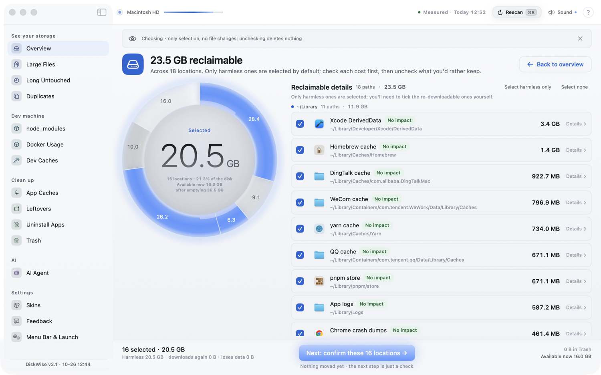 | 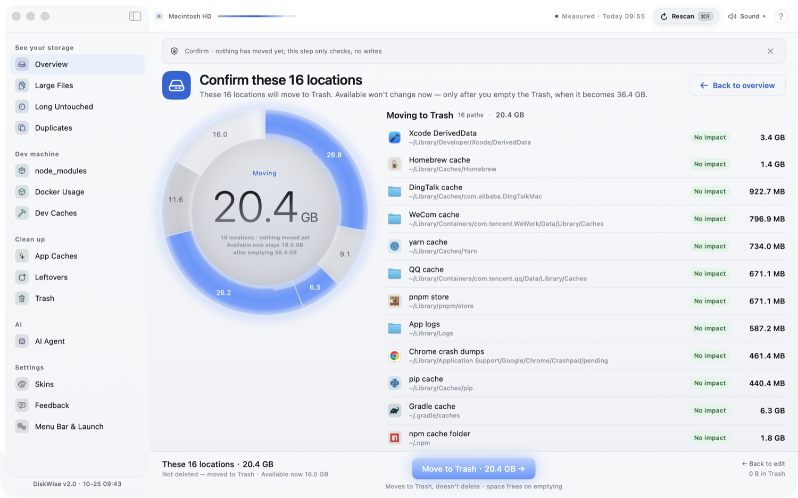 |

| Overview | Duplicates |
|---|---|
| 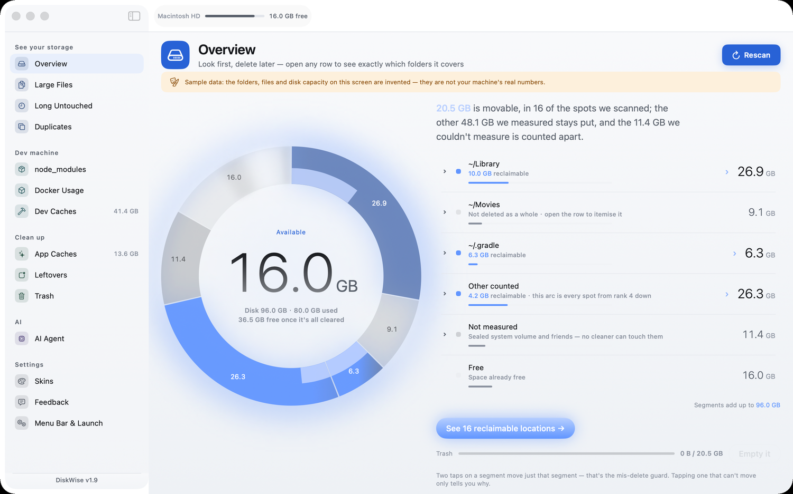 | 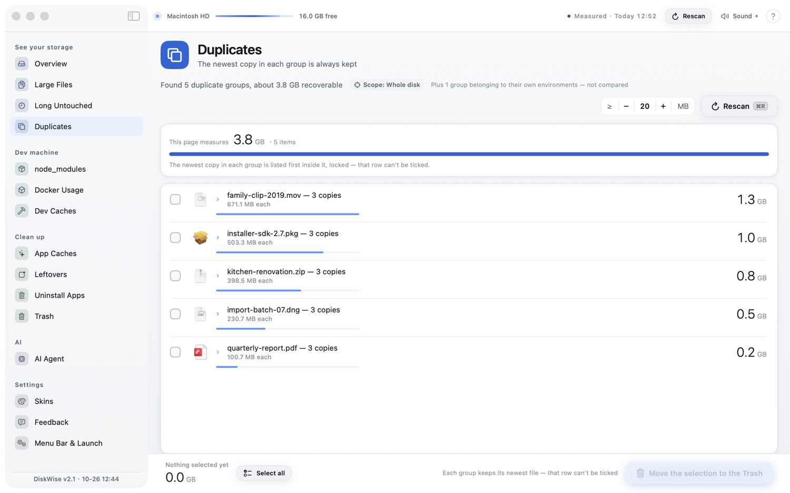 |

| Dev Caches | Leftovers |
|---|---|
| 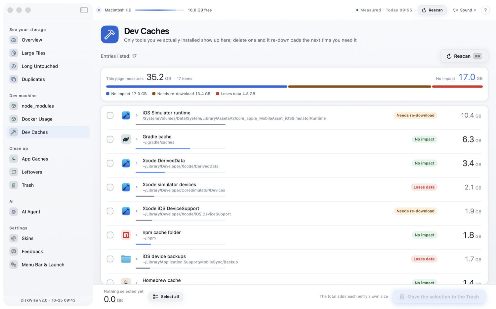 | 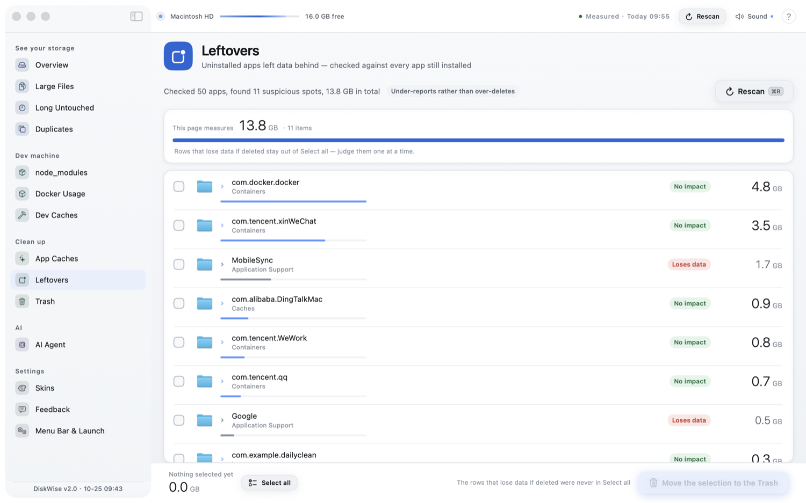 |

One page for whole apps — the app itself, plus the folders in your home that provably belong to
it. A folder only appears here when it carries the app's bundle ID or a name derived from it:

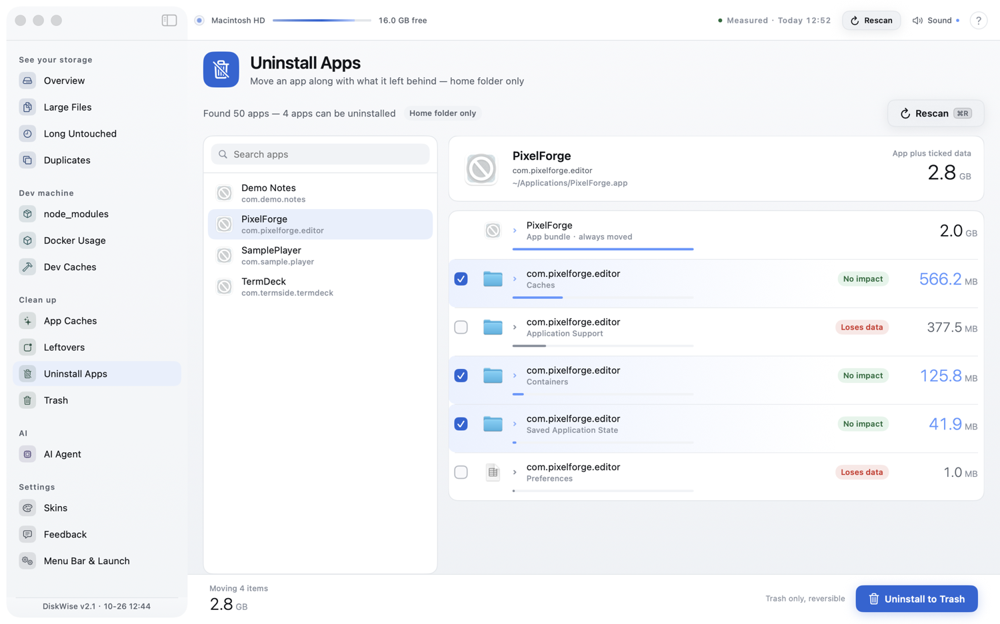

The skin store renders a **live thumbnail** of each theme — mini sidebar, ring gauge, rows and
buttons, all drawn with that skin's real tokens — so you can see the skeleton before you wear it:

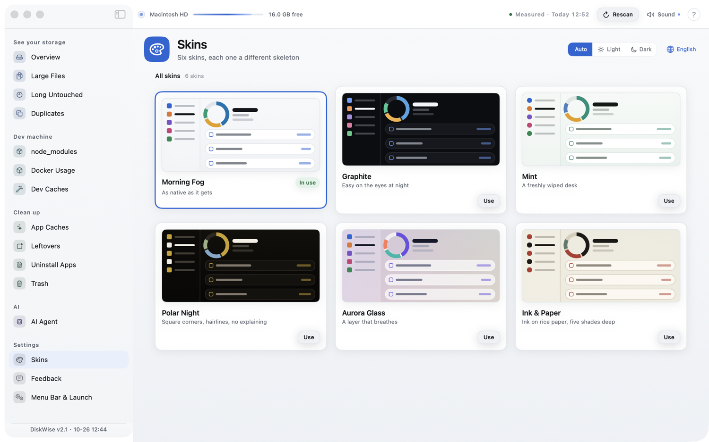

Six skins, six skeletons. Same page, three of them — Graphite is the dark one:

| Graphite | Mint | Polar Night |
|---|---|---|
| 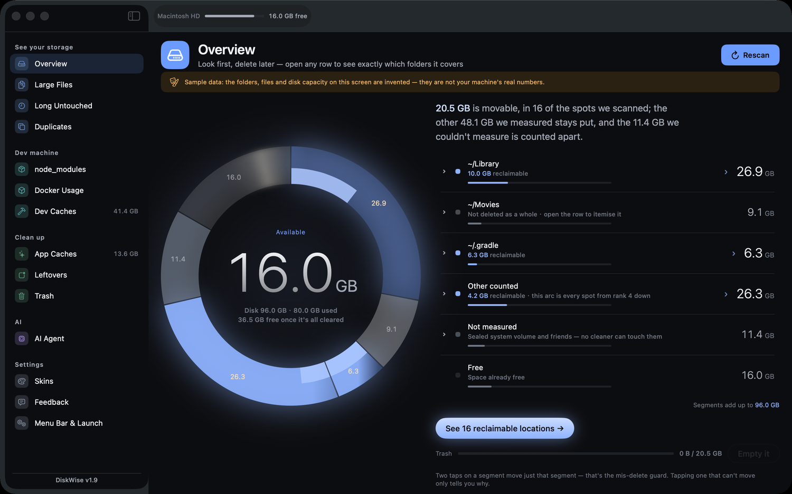 | 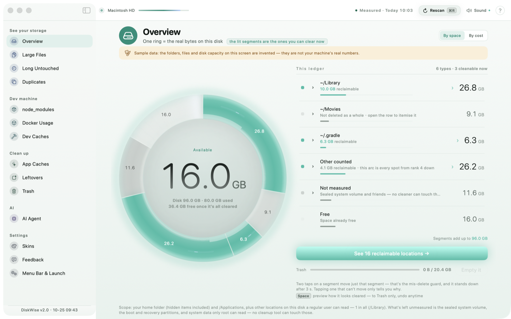 | 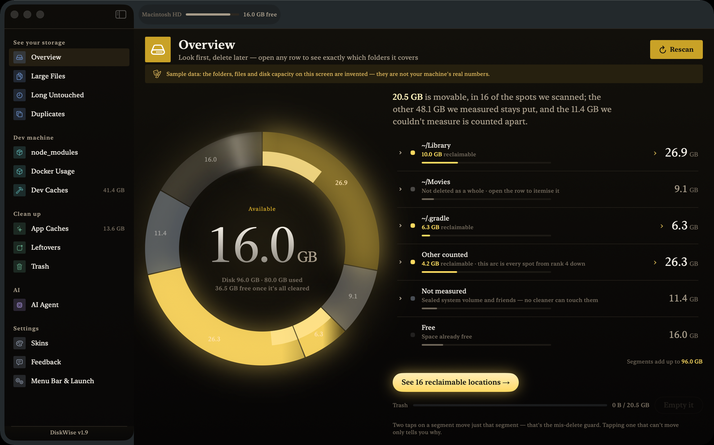 |

The UI ships in ten languages — English, Simplified and Traditional Chinese, Japanese, Korean,
German, Spanish, French, Russian and Brazilian Portuguese — switchable from the language menu on
the Skins page, and following the system language by default. Same screens in Chinese:

| 空间总览 | 开发缓存 |
|---|---|
| 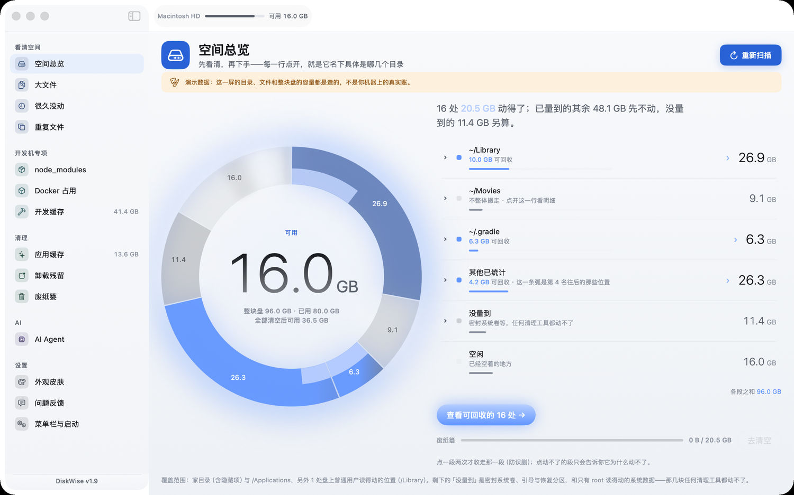 | 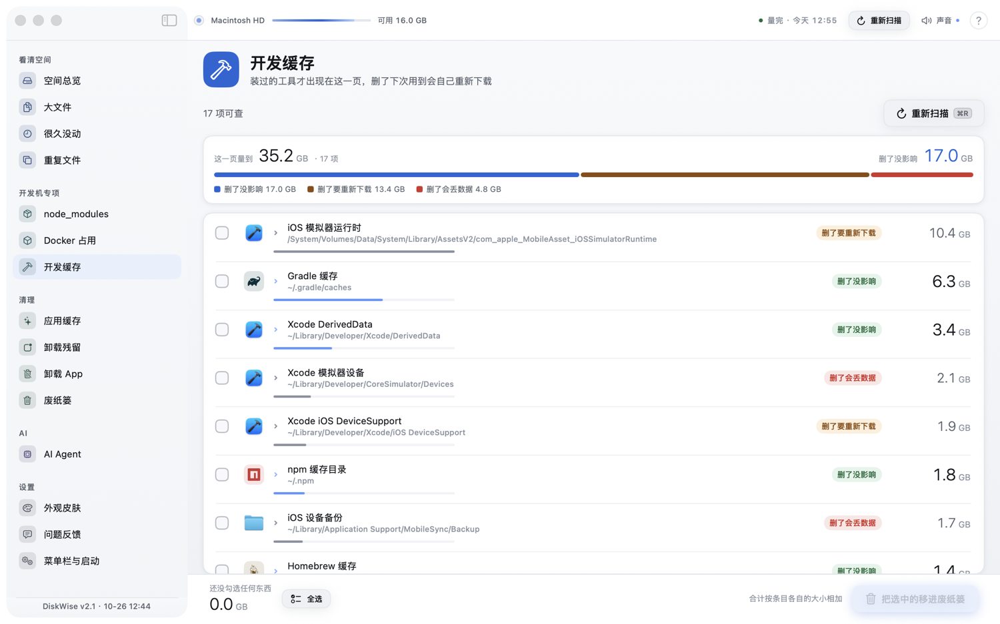 |

Counts are inflected per language rather than pasted together in English: Russian picks its own form
for every number (`1 файл`, `3 файла`, `11 групп`), German and the Romance languages inflect
singular/plural, and Japanese and Korean use the measure word those languages actually use.

## Install

### Mac App Store

[DiskWise: Storage Cleaner](https://apps.apple.com/app/id6813265402) — macOS 13+, free, install it and
start using it; the store takes care of every version after that.

Each of those versions has to clear Apple's review first, so the store can trail a GitHub release. If
you want the newest build the moment it ships, use Homebrew or the DMG below.

### Homebrew

```sh
brew tap DreamOfXM/diskwise https://github.com/DreamOfXM/diskwise
brew install --cask dreamofxm/diskwise/diskwise
```

The cask is `Casks/diskwise.rb` in this same repository, so the tap has to be pointed at it by
URL: `dreamofxm/diskwise` on its own would send Homebrew looking for a `homebrew-*` repository
that does not exist. After the tap, install by the fully-qualified name — since Homebrew 6
non-official taps are untrusted by default, and installing by full name trusts just this cask.
That first tap clones this repository's whole history, roughly 300 MB, so on a slow link it sits
in silence for a while; the DMG it then installs is about 10 MB.
If Homebrew asks for more than that:

```sh
brew trust --cask dreamofxm/diskwise/diskwise
brew install --cask diskwise
```

Tap details and how the pinned checksum gets bumped: [docs/homebrew.md](./docs/homebrew.md).

Homebrew installs the same file the Releases page carries. From v1.7 it is signed with a Developer ID
certificate and notarized by Apple, so it opens on a double-click and never reaches that step. Releases
before v1.7 were built ad-hoc, so macOS stops the first launch once and you approve it in
**System Settings → Privacy & Security → Open Anyway** (on macOS 13–14, right-click → Open does the
same job). Getting it from the **Mac App Store** skips that step entirely.

### DMG

1. Download `DiskWise-<version>[-universal].dmg` from
   [Releases](https://github.com/DreamOfXM/diskwise/releases).
2. Open it and drag **DiskWise.app** to *Applications*.
3. Double-click it. From v1.7 that just works — the app is Developer ID signed and notarized. On a
   pre-v1.7 build the first launch gets stopped once; approve it in **System Settings → Privacy &
   Security → Open Anyway** and the app opens normally from then on (on macOS 13–14, right-click → Open
   works instead; Sequoia removed that shortcut).

Releases built with `ARCH=universal` are named `…-universal.dmg` and carry both the Apple
Silicon and Intel slices in one file; the Apple Silicon-only ones are named `DiskWise-<version>.dmg`.
Checksums are published next to each release asset, and the cask pins the same SHA-256.

## Build from source

You need the Xcode Command Line Tools — **not** full Xcode.

```bash
swift build                    # debug
swift run SelfTest             # all green is the precondition for shipping
swift run DiskCleaner          # run the app
bash build_app/build.sh        # localize check → build → self-test → .app → sign → dist/*.dmg + SHA256
```

`build.sh` refuses to produce a package if any of the three gates fails: missing translations, a
failing self-test, or an unpacked resource. The translation gate parses the Swift sources and
`skins.json` itself, so it catches a user-visible string that was never wrapped in `L(…)` as well as
a missing translation — a language can't silently ship half-translated.

Contributing? Start with [CONTRIBUTING.md](CONTRIBUTING.md), then
[docs/ARCHITECTURE.md](docs/ARCHITECTURE.md) and [docs/DESIGN.md](docs/DESIGN.md) — both encode
rules that were learned the expensive way. Three PRs need no Swift at all: a
[cache knowledge base](CONTRIBUTING.md#the-easiest-useful-contribution-cache-knowledge-base) entry, a
[skin](CONTRIBUTING.md#skins), or a [translation](CONTRIBUTING.md#translations).

## FAQ

**Is this a CleanMyMac alternative?**
In the sense that it covers the same ground — caches, large files, duplicates, uninstall
leftovers, Docker usage — with the source on this page and no subscription. It deliberately
does *less* than a suite: no malware scan, no VPN, no mail cleanup, no "speed booster",
because those are different products with different risks.

**Can it delete something I actually need?**
Anything it removes lands in the Trash, and the session keeps an undo stack. Home itself and
`~/Library` can never be removed wholesale. Emptying the Trash is Finder's job, so macOS asks
you one more time before space is really gone.

**Is it safe to delete `node_modules`, `DerivedData`, caches?**
`node_modules` comes back with `npm install`, `DerivedData` with the next Xcode build, and
caches with the next run of the tool that wrote them. DiskWise states that per entry rather
than assuming you know it — each cache row says what it is, what happens if you delete it, and
how to get it back.

**Does it send data anywhere?**
No. No updater, no analytics, no account, no ads — the app has no network access at all, which
is also why feedback goes through GitHub or email below.

**What about WeChat / DingTalk / WeCom caches?**
They're in the cache knowledge base, because on a Chinese developer's Mac those are often the
single biggest consumers. That's why Simplified and Traditional Chinese are both first-class here
rather than a translation bolted onto an English UI.

**Intel Mac?**
From v1.3 on, every published DMG is built with `ARCH=universal` and carries both the arm64 and
x86_64 slices in one file, so the same download works on Apple Silicon and Intel. Releases before
v1.3 shipped an arm64-only file (`DiskWise-<version>.dmg`, no `-universal` in the name); Intel
users on those versions need to build from source instead (it takes a minute and needs no Xcode).
`bash build_app/build.sh` still defaults to Apple Silicon; pass `ARCH=universal` to get both.

**Why does macOS complain on first launch?**
From v1.7 it doesn't: every release from that version onward is signed with a Developer ID certificate
and notarized by Apple, so Gatekeeper lets it open. The ad-hoc builds before it get stopped once —
approve it in **System Settings → Privacy & Security → Open Anyway** and it launches normally
afterwards; on macOS 13–14 right-click → Open does the same job, a shortcut Sequoia removed. The App
Store build never gets stopped.

## Known limits

- **The system area is counted, not cleaned.** Rows under `/Library`, `/opt` or `/private` come up
  with a *System area* badge and a locked checkbox: either only an admin can write there, or the
  files belong to Homebrew / Xcode, whose own cleanup commands do a better job.
- **Large `node_modules` sweeps are slow** and don't stream results yet.
- **It will not find every orphan.** Leftover detection is deliberately conservative.

## Roadmap

- [ ] Streaming snapshots for slow scans
- [ ] More cache knowledge base entries (open a PR — this is the easiest way to contribute)

## Feedback

The app has no network access, so there is no built-in "send feedback" button — pick a channel:

| Channel | Where |
|---|---|
| Email | [hnyxgxm2009@163.com](mailto:hnyxgxm2009@163.com) |
| GitHub | [Open an issue](https://github.com/DreamOfXM/diskwise/issues) — English or Chinese is fine |
| Discussions | [Questions, ideas, show-and-tell](https://github.com/DreamOfXM/diskwise/discussions) |

Email and issues also live in-app: the **Feedback** page at the bottom of the sidebar, with
copy buttons for every address.

If it cleared space you didn't know you had, [starring the repo](https://github.com/DreamOfXM/diskwise)
is genuinely how the next person finds it — there is no marketing budget behind this project, so GitHub
search and awesome-list traffic are what decide whether anyone sees it at all.

## Privacy

DiskWise has no network access and collects nothing — every scan runs locally on your Mac.
Full policy: [docs/PRIVACY.md](docs/PRIVACY.md).

## License

Apache License 2.0 — see [LICENSE](LICENSE).
